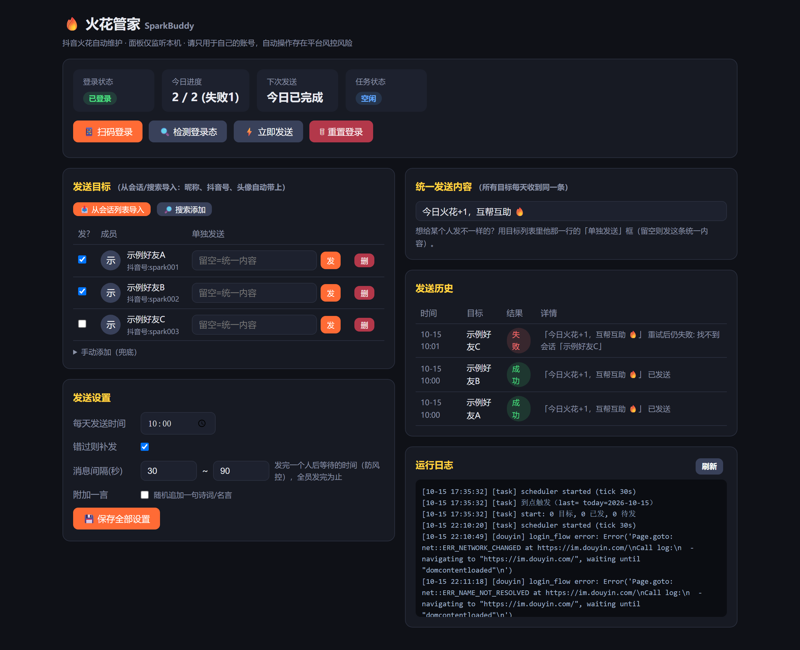
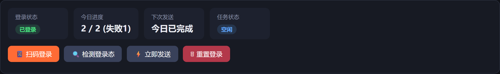
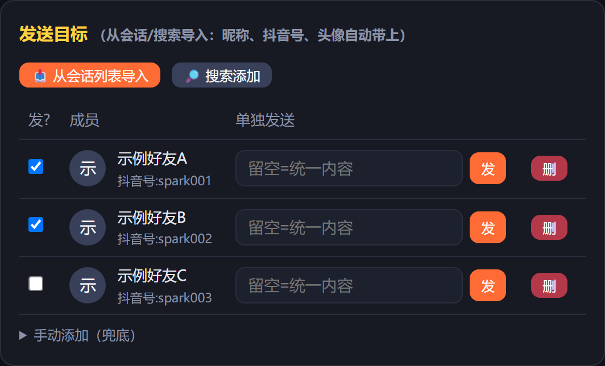
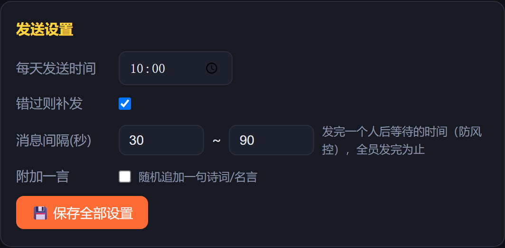
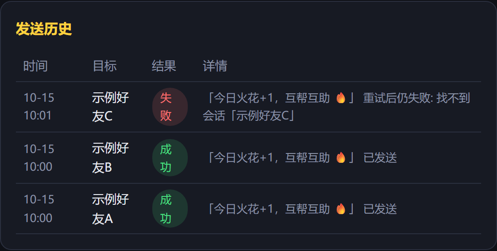

<div align="center">


# 🔥 火花管家 SparkBuddy

**抖音互火自动维护助手 —— 每天定时给指定好友自动发一条消息，稳住你的火花**

扫码登录 · 网页面板 · 定时发送 · 失败自动重试 · 防风控限速


</div>

---

## 📸 界面预览



> 截图为演示数据（示例好友A/B/C），非真实联系人。

## ✨ 功能特性

| 功能 | 说明 |
|------|------|
| 📱 扫码登录 | 弹出真实浏览器，抖音 APP 扫一下即可；登录态持久化保存，**一次登录长期有效**，不碰密码 |
| 📥 好友导入 | 「从会话列表导入」一键抓取聊过天的好友（昵称 / 抖音号 / 头像自动带上）；也可「搜索添加」 |
| ⏰ 定时发送 | 每天到点自动发送；错过时间（如电脑当时关机）下次启动面板**自动补发** |
| ✉️ 统一内容 | 一个输入框写好内容，所有人每天收到同一条；也可以在某个人旁边**单独发送**自定义内容 |
| 🔁 失败重试 | 发送失败自动重试 1 次（全新浏览器会话），仍失败则在历史中报告原因 |
| ✅ 发送强校验 | 消息气泡真实出现在聊天窗口才算成功，杜绝"假发送" |
| 🛡️ 防风控 | 每人每天 1 条、好友之间随机间隔（默认 30~90 秒，可调）、面板仅监听本机 127.0.0.1 |
| 🧾 全程可查 | 发送历史（成功/失败/原因）+ 运行日志，一切尽在面板 |

## 🧠 工作原理（为什么它比较稳）

- **登录判定用 cookie，不看页面 DOM**：以 `sessionid` cookie 是否存在判断登录态，抖音页面改版不影响登录检测。
- **发送走真实浏览器**（Playwright + 持久化 Chromium Profile），不用任何协议逆向，风控风险最低。
- **发送强校验**：输入 → 回车 → 等待消息气泡真实出现 → 才记成功；每一步失败都有明确原因。
- **短路径 DOM 操作**：定位会话和输入框的 selector 全部写成候选链，集中在 `app/douyin.py` 顶部，页面改版只需改一处。

## 📦 安装（Windows）

> 前置要求：[Python 3.10+](https://www.python.org/downloads/)（安装时勾选 *Add python.exe to PATH*）

```bat
git clone https://github.com/xingchenyd/spark-buddy.git
cd spark-buddy
install.bat   :: 首次运行一次：建 venv + 装依赖 + 下载 Chromium（约150MB）
start.bat     :: 以后每天双击这个：启动面板并自动打开浏览器
```

<details>
<summary>手动命令版（与脚本等价）</summary>

```bat
python -m venv .venv
.venv\Scripts\python.exe -m pip install -r requirements.txt -i https://pypi.org/simple
.venv\Scripts\python.exe -m playwright install chromium
.venv\Scripts\python.exe -m uvicorn app.main:app --host 127.0.0.1 --port 8765
```
</details>

可选：以管理员运行 `python deploy_make_shortcut.py`，在桌面生成带图标的「火花管家」快捷方式。

## 🚀 使用指南（3 步上手）

**① 扫码登录**：点「扫码登录」，屏幕上会弹出浏览器窗口 → 用抖音 APP 扫码确认 → 面板自动变为「已登录」，浏览器随后自动关闭（登录态保存在本地，无需重复扫码）。



**② 添加好友**：点「从会话列表导入」，自动读取你聊过天的好友 → 勾选 → 添加。火花对象基本都在会话列表里。



**③ 设置并发送**：设定每天发送时间（默认 10:00）和统一发送内容 → 保存。到点自动发给所有勾选的好友；也可随时点「立即发送」，或在某个人旁边填入内容单独发送。



发送历史里每一条都有结果和原因：



## 📂 数据文件说明

| 路径 | 内容 | 敏感性 |
|------|------|--------|
| `data/config.json` | 发送时间、消息内容、目标列表 | 一般 |
| `data/state.json` | 当日调度状态（今天是否已发） | 一般 |
| `data/history.jsonl` | 发送历史（时间/对象/结果/原因） | 含好友昵称 |
| `logs/app.log` | 运行日志 | 一般 |
| `browser_data/` | **浏览器登录态（含 session cookie）** | ⚠️ **高度敏感，勿外传** |

以上目录均已加入 `.gitignore`，不会被提交到仓库。**换电脑时把整个项目目录拷过去即可无缝续用**（或至少带走 `browser_data/` 和 `data/`）。

## ❓ 常见问题

<details>
<summary><b>提示"找不到会话 ××"</b></summary>

- 目标昵称必须与抖音聊天列表中显示的**完全一致**（含 emoji）；
- 从没聊过天的好友先手动发一句，让他出现在会话列表里；
- 推荐直接用「从会话列表导入」，从源头保证昵称一致。
</details>

<details>
<summary><b>提示"登录态已失效"</b></summary>

抖音登录态通常数月有效；失效后重新点「扫码登录」扫一次即可，配置和历史不会丢。
</details>

<details>
<summary><b>页面改版导致定位失败</b></summary>

会话搜索框、聊天输入框、发送按钮的 selector 全部是**候选链**，集中在 `app/douyin.py` 顶部的 `SEARCH_SELECTORS / INPUT_SELECTORS / SEND_BUTTON_SELECTORS`，按新页面结构增删一行即可。
</details>

<details>
<summary><b>想换端口 / 局域网访问</b></summary>

改 `start.bat` 里的 `--port 8765`。面板只监听 127.0.0.1，如需手机访问请自行改 `--host 0.0.0.0` 并加防火墙放行（注意：这意味着局域网内任何人都能操作你的面板）。
</details>

<details>
<summary><b>关掉控制台窗口会怎样</b></summary>

服务随之停止，当天定时任务不再执行。想让它全天候待命就让窗口开着（或自行注册为计划任务/服务）。
</details>

## ⚠️ 风险与免责声明

- 自动化操作社交平台存在**风控风险**（验证码、限流乃至封号），请只用于**本人拥有**的账号，并保持默认的保守发送频率；
- 本项目仅供学习交流与个人自动化使用，**禁止商业用途**；
- 使用本项目产生的一切后果由使用者自行承担。

## 🙏 致谢

项目灵感来自 [halfwaystudent/douyin-sparkflow](https://github.com/halfwaystudent/douyin-sparkflow)（原 `im.douyin.com` 独立站已下线，本项目改用主站消息中心并重写了整套登录与发送链路）。

## License

[MIT](LICENSE) © 2026 xingchenyd
