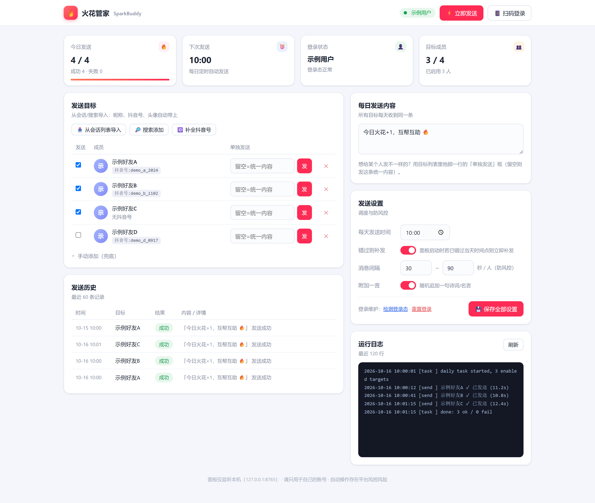
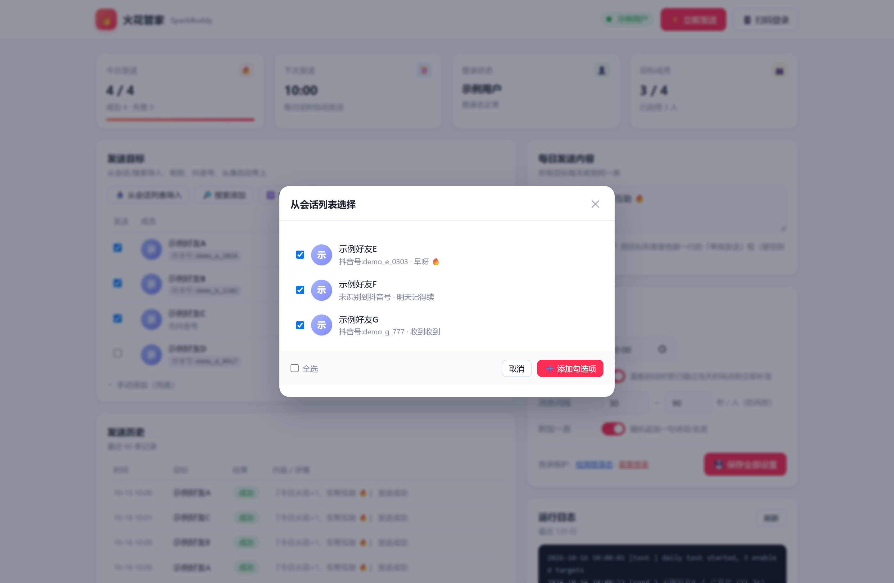

<div align="center">


# 🔥 火花管家 SparkBuddy

**抖音互火自动维护助手 —— 每天定时给指定好友自动发一条消息，稳住你的火花**

扫码登录 · 网页面板 · 定时发送 · 失败自动重试 · 防风控限速


</div>

---

## 📸 界面预览





> 截图为演示数据（示例好友A/B/C），非真实联系人。

## ✨ 功能特性

| 功能 | 说明 |
|------|------|
| 📱 扫码登录 | 弹出真实浏览器，抖音 APP 扫一下即可；登录态持久化保存，**一次登录长期有效**，不碰密码 |
| 📥 好友导入 | 首次使用**自动导入全部带火花的好友**（零配置起步）；也可「从会话列表导入」「⚡ 一键导入全部火花好友」「搜索添加」，昵称 / 头像 / 火花数自动带上 |
| ⏰ 定时发送 | 每天到点自动发送；错过时间（如电脑当时关机）下次启动面板**自动补发** |
| ✉️ 统一内容 | 一个输入框写好内容，所有人每天收到同一条；也可以在某个人旁边**单独发送**自定义内容 |
| 🖼️ 头像自动补全 | 发送时顺手抓取会话头像，**缺头像的目标下次发送自动补上**，无需手动操作 |
| 🔁 失败处理 | 失败不在当场重试（全部跑完一遍为止）；失败的用「立即发送」一键补发，或在设置里开启「失败追加第二轮」 |
| ✅ 发送强校验 | 消息气泡真实出现在聊天窗口才算成功，杜绝"假发送" |
| 🛡️ 防风控 | 每人每天 1 条、好友之间随机间隔（默认 30~90 秒，可调）、面板仅监听本机 127.0.0.1 |
| 🧾 全程可查 | 发送历史（成功/失败/原因）+ 运行日志，一切尽在面板 |

## 🧠 工作原理（为什么它比较稳）

- **登录判定用 cookie，不看页面 DOM**：以 `sessionid` cookie 是否存在判断登录态，抖音页面改版不影响登录检测。
- **发送走真实浏览器**（Playwright + 持久化 Chromium Profile），不用任何协议逆向，风控风险最低。
- **发送强校验（2026-11-16 重写）**：先严格确认文本确实写入输入框，写不进去就不按回车；发送后以「输入框被清空」或「新增我方消息行」判成功。旧的「整页固定文本出现次数」方案会因历史消息、会话预览、虚拟列表异步渲染而随机漂移，同时制造假成功和假失败，已废弃。
- **一天最多发一次（幂等锁，2026-11-17）**：在按下发送键**之前**把动作写进 `data/send_attempts.jsonl`。之后无论校验成功、失败还是程序崩溃，当天都不会对同一目标再发第二次；调度器按「是否执行过动作」而非「是否校验成功」筛选待发目标，彻底切断「校验误判 → 整轮重试 → 重复打扰」的链路。
- **基础设施故障短路**：浏览器缺失 / 网络不通 / 登录失效时整轮立即中止，不逐个消耗目标、不写假失败、不把当天标记成已跑；退避 5 分钟后自动重试，只补今天尚未执行过发送动作的目标。
- **整轮只启动一次浏览器**：旧版每发一个目标都冷启动一次 Chromium 并等 30 秒侧栏，10 个目标就是 10 个失败窗口；现在批次内复用同一上下文。
- **短路径 DOM 操作**：定位会话和输入框的 selector 全部写成候选链，集中在 `app/douyin.py` 顶部，页面改版只需改一处。

## 📦 安装（Windows）

> 前置要求：[Python 3.10+](https://www.python.org/downloads/)（安装时勾选 *Add python.exe to PATH*）

```bat
git clone https://github.com/xingchenyd/spark-buddy.git
cd spark-buddy
install.bat   :: 首次运行一次：建 venv + 装依赖 + 下载 Chromium（约150MB）
start.bat     :: 以后每天双击这个：启动面板并自动打开浏览器
```

<details>
<summary>手动命令版（与脚本等价）</summary>

```bat
python -m venv .venv
.venv\Scripts\python.exe -m pip install -r requirements.txt -i https://pypi.org/simple
set PLAYWRIGHT_BROWSERS_PATH=%CD%\.pw-browsers
.venv\Scripts\python.exe -m playwright install chromium
.venv\Scripts\python.exe -m uvicorn app.main:app --host 127.0.0.1 --port 8765
```
</details>

可选：以管理员运行 `python deploy_make_shortcut.py`，在桌面生成带图标的「火花管家」快捷方式。

## 🚀 使用指南（3 步上手）

**① 扫码登录**：点「扫码登录」，屏幕上会弹出浏览器窗口 → 用抖音 APP 扫码确认 → 面板自动变为「已登录」，浏览器随后自动关闭（登录态保存在本地，无需重复扫码）。


**② 添加好友**：首次使用登录后会**自动导入全部带火花的好友**并启用，开箱即用；之后可随时「从会话列表导入」勾选添加，或点「⚡ 一键导入全部火花好友」把新有火花的会话补进来。搜不到的人可用「搜索添加」或手动添加（可填抖音号区分重名）。

**③ 设置并发送**：设定每天发送时间（默认 10:00）和统一发送内容 → 保存。到点自动发给所有勾选的好友；也可随时点「立即发送」，或在某个人旁边填入内容单独发送。发送历史里每一条都有结果和原因。

## 📂 数据文件说明

| 路径 | 内容 | 敏感性 |
|------|------|--------|
| `data/config.json` | 发送时间、消息内容、目标列表 | 一般 |
| `data/state.json` | 当日调度状态（今天是否已发） | 一般 |
| `data/history.jsonl` | 发送历史（时间/对象/结果/原因） | 含好友昵称 |
| `data/send_attempts.jsonl` | 每日每目标的发送动作流水（幂等锁，勿手动删除） | 含好友昵称 |
| `data/browser_exe.json` | 上次实际使用的浏览器路径（固定复用，避免 Profile 跨版本来回升级） | 一般 |
| `logs/app.log` | 运行日志 | 一般 |
| `browser_data/` | **浏览器登录态（含 session cookie）** | ⚠️ **高度敏感，勿外传** |
| `.pw-browsers/` | 项目私有 Chromium（约 150MB，与全局缓存隔离） | 无 |

以上目录均已加入 `.gitignore`，不会被提交到仓库。**换电脑时把整个项目目录拷过去即可无缝续用**（或至少带走 `browser_data/` 和 `data/`）。

### 自检（不发送任何消息）

```bat
.venv\Scripts\python.exe selftest.py          :: 离线 + 浏览器启动，约 10 秒
.venv\Scripts\python.exe selftest.py --live   :: 追加只读打开消息中心，约 1 分钟
```

自检覆盖浏览器自动发现、持久化上下文启动、输入框严格写入、消息行增量校验、基础设施故障短路与浏览器锁释放。任何一项 FAIL 都不建议直接跑正式发送。

## ❓ 常见问题

<details>
<summary><b>同一个好友一天收到好几条重复消息 / 面板显示全部失败但手机上其实收到了</b></summary>

2026-11-17 修复的根因，两层：

1. 抖音聊天输入框是 Slate 编辑器，**清空后 `innerText` 是零宽空格 U+200B 而不是空串**。旧版把「输入框已清空」误判为「还有文本」，于是 ① 每条都记 FAIL；② 触发「Enter 之后再点一次发送按钮」的兜底，一次动作实际发了两条。
2. 调度器只把 `ok=True` 当成「今天已处理」，看到全 FAIL 就又跑一整轮，两轮叠加变成 4 条。

现在：零宽空格按空处理；输入框只认 `[data-slate-editor]` 且必须存在聊天输入区 `messageMsgInput`（侧栏搜索框面积更大，旧版按面积选会误把消息打进搜索框，对应「部分人没发」）；删除兜底点击；每个目标每天最多一次发送动作。

如果**确实需要**当天对某人再发一次，用面板单独发送并显式带 `force`（用户主动操作才允许）。日常自动发送永不重发。
</details>

<details>
<summary><b>面板被启动了两次 / 任务管理器里有两个 pythonw.exe</b></summary>

`start.bat` 的 WMI 创建与 fallback 曾在同一秒拉起两个面板进程。现在 `launch_panel.py` 启动时先抢 Windows 命名互斥体 `Local\SparkBuddyPanelSingleton`，第二个进程立即退出，端口竞态不再有影响。
</details>

<details>
<summary><b>所有目标同一天一起失败，或报 "Executable doesn't exist at chromium-1194"</b></summary>

这是 2026-11-16 修复的根因：Playwright 默认从**全局共享缓存** `%LOCALAPPDATA%\ms-playwright` 按固定 revision 找浏览器，其它项目升级 Playwright 或清理缓存会把它删掉。此时每个目标必然失败，旧版还会把失败写进历史并把当天标记成「已跑」，导致当天再也不会自动补发。

现在的处理：浏览器装进项目私有 `.pw-browsers/`，启动时自动发现私有缓存 / 全局缓存 / 系统 Edge 或 Chrome 中可用的最新版本并显式传给 Playwright；彻底找不到会自动下载；并把实际使用的路径记在 `data/browser_exe.json` 固定复用（避免持久化 Profile 跨版本来回升级）。

遇到这个提示先跑 `selftest.py`；若仍失败，重新执行一次 `install.bat` 即可。环境恢复后会自动补发今天尚未成功的目标，无需手动点「立即发送」。
</details>

<details>
<summary><b>面板状态里出现「环境未就绪」</b></summary>

说明浏览器 / 网络 / 登录态三者之一异常。此时**没有发送、也没有写入失败历史**，面板会退避 5 分钟自动重试。可在 `/api/status` 的 `browser`、`infra_error` 字段看到具体原因；对应处理依次是：跑 `install.bat`、检查网络或代理、点「扫码登录」。
</details>

<details>
<summary><b>提示"找不到会话 ××"</b></summary>

- 目标昵称必须与抖音聊天列表中显示的**完全一致**（含 emoji）；
- 从没聊过天的好友先手动发一句，让他出现在会话列表里；
- 推荐直接用「从会话列表导入」，从源头保证昵称一致。
</details>

<details>
<summary><b>提示"登录态已失效"</b></summary>

抖音登录态通常数月有效；失效后重新点「扫码登录」扫一次即可，配置和历史不会丢。
</details>

<details>
<summary><b>页面改版导致定位失败</b></summary>

会话搜索框、聊天输入框、发送按钮的 selector 全部是**候选链**，集中在 `app/douyin.py` 顶部的 `SEARCH_SELECTORS / INPUT_SELECTORS / SEND_BUTTON_SELECTORS`，按新页面结构增删一行即可。
</details>

<details>
<summary><b>想换端口 / 局域网访问</b></summary>

改 `start.bat` 里的 `--port 8765`。面板只监听 127.0.0.1，如需手机访问请自行改 `--host 0.0.0.0` 并加防火墙放行（注意：这意味着局域网内任何人都能操作你的面板）。
</details>

<details>
<summary><b>面板在后台运行，怎么停止？</b></summary>

双击快捷方式后面板以**无窗口方式在后台运行**（任务管理器里对应 `pythonw.exe`）。启动时弹出的黑色窗口几秒后会自行消失，属正常现象——**中途关掉它也不影响面板**（进程经 WMI 创建，与启动窗口完全脱离）。重启电脑后首次启动可能需要近一分钟（杀毒扫描等），**浏览器就绪后会自动弹出，无需守着窗口**。

停止方式任选其一：打开面板 → 「发送设置」底部 → 点「停止面板」；或在任务管理器结束 `pythonw.exe`。电脑关机/重启后面板不会自动启动，需再次双击快捷方式（想开机自启可自行注册为计划任务）。

面板无响应时排查 `logs/panel_bg.log`（后台运行的全部输出）与 `logs/app.log`（应用日志）。
</details>

## ⚠️ 风险与免责声明

- 自动化操作社交平台存在**风控风险**（验证码、限流乃至封号），请只用于**本人拥有**的账号，并保持默认的保守发送频率；
- 本项目仅供学习交流与个人自动化使用，**禁止商业用途**；
- 使用本项目产生的一切后果由使用者自行承担。

## 🙏 致谢

项目灵感来自 [halfwaystudent/douyin-sparkflow](https://github.com/halfwaystudent/douyin-sparkflow)（原 `im.douyin.com` 独立站已下线，本项目改用主站消息中心并重写了整套登录与发送链路）。

## License

[MIT](LICENSE) © 2026 xingchenyd
